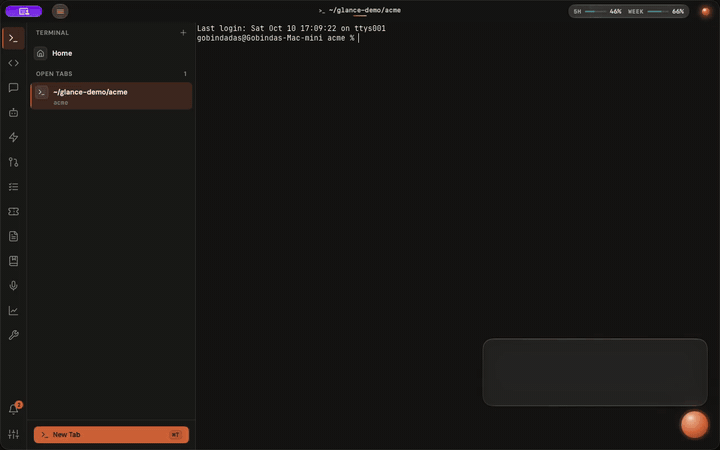
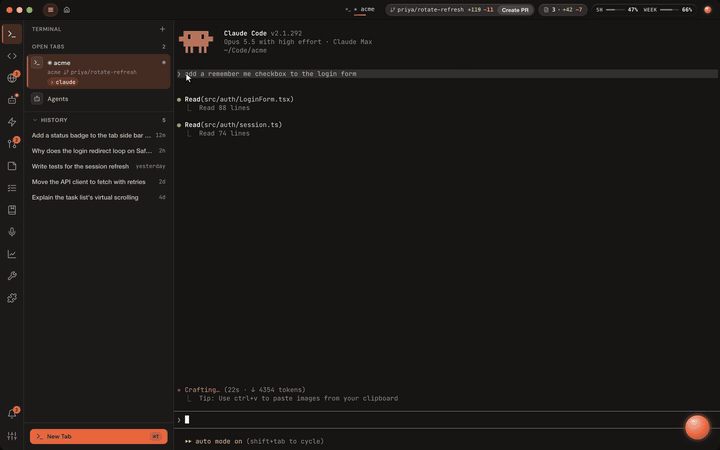
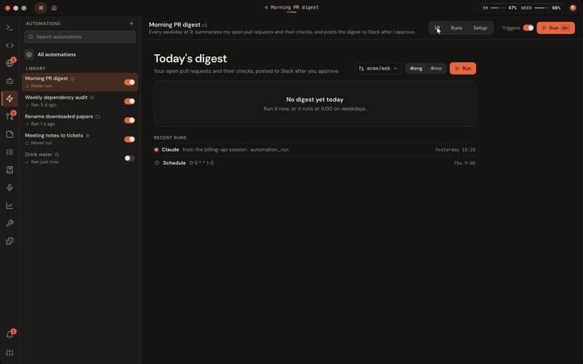
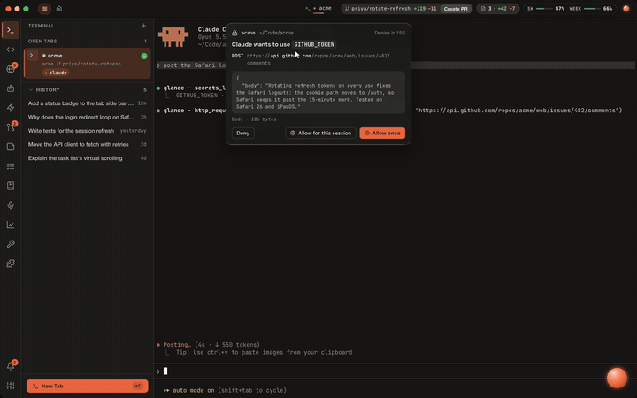
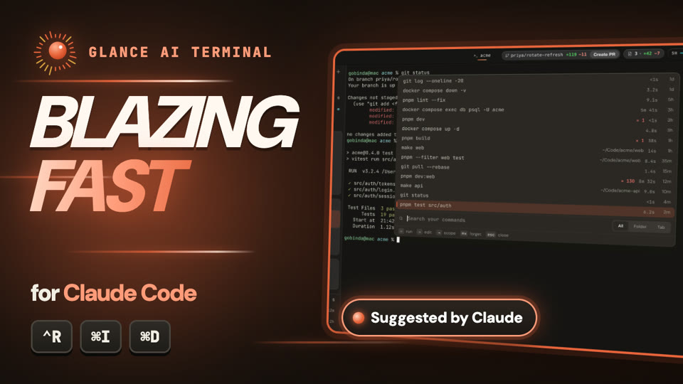

<p align="center">
  <picture>
    <source media="(prefers-color-scheme: dark)" srcset="assets/readme/hero-dark.svg">
    
  </picture>
</p>

<p align="center">
  <a href="https://github.com/gobinda168/glance-studio/releases/latest"></a>
  
  <a href="LICENSE"></a>
  <a href="https://ghostty.org"></a>
  
</p>

<p align="center">
  <a href="https://github.com/gobinda168/glance-studio/releases/download/feed-terminal/Glance-Studio.dmg"></a>
  &nbsp;
  <a href="https://glance.buildwithgd.in"></a>
</p>

Glance Studio is a macOS workspace for Claude Code: a terminal built on [Ghostty](https://ghostty.org), with editors,
pull requests, a browser, notes and automations around it. Claude's replies are read aloud and drawn as they're
spoken, agents and automations run in the background, and your secrets stay out of the model's sight. This repository
is its source, under the GPL-3.0 (see [License](#license)).

https://github.com/user-attachments/assets/525d44c8-ff59-47e4-a605-8d96478df776

<p align="center"><sub>First run: set up in a minute, then straight to work.</sub></p>

## See it work

<table>
  <tr>
    <td width="50%" valign="top">
      
      <p><b>Replies you can hear and see.</b> Markdown, code and real Mermaid diagrams, read aloud while each diagram draws itself.</p>
    </td>
    <td width="50%" valign="top">
      
      <p><b>Agents.</b> Claude works on a trigger, like a red CI run, and stops to ask you before it decides anything.</p>
    </td>
  </tr>
  <tr>
    <td width="50%" valign="top">
      
      <p><b>Automations.</b> Describe a chore once. Claude builds it, and it runs on a schedule after you approve it.</p>
    </td>
    <td width="50%" valign="top">
      
      <p><b>Secrets.</b> Claude uses your tokens through Glance, approved with Touch ID. It never sees them.</p>
    </td>
  </tr>
</table>

<p align="center">
  <a href="https://www.youtube.com/watch?v=le-XBNeWk9o"></a>
  <br><sub>▶ The full terminal tour on YouTube (1:42)</sub>
</p>

## The Glance panel

At its heart is the Glance panel, a voice-orb explainer for Claude Code. When Claude finishes a reply, Glance docks a
panel to the right of your terminal window and does three things:

- renders the reply properly: Markdown, highlighted code, real Mermaid diagrams;
- reads it aloud in a natural tone, while a luminous orb and spectrum ring react to the voice;
- draws each diagram piece by piece while the matching paragraph is spoken.

The panel never takes keyboard focus, so you keep typing in the terminal. It hides when you leave the terminal.

Glance docks to Warp, Terminal, iTerm2, Ghostty, WezTerm, kitty, Alacritty, Hyper, Tabby, Wave and Rio, and to the
built-in terminal of VS Code, VSCodium, Cursor, Windsurf and Zed (the list is `Sources/GlanceCore/TerminalApps.swift`).
Switch terminals and the panel moves to the one in front.

Native Swift (AppKit + SwiftUI + AVFoundation), about 40 MB in memory. The panel is a local page in a `WKWebView`
(`Web/`, the Claude Design "Glance Panel v11" overlay) with vendored markdown-it, highlight.js, Mermaid and fonts. Needs no Xcode; the Command Line Tools are enough.

## VS Code extension

`vscode/` is Glance as a VS Code extension: the same panel (it loads `Web/`) in a view you can keep in the Secondary
Side Bar, for Claude Code in any terminal or in the Claude Code extension. It needs no hooks: it follows the
transcripts in `~/.claude/projects` for sessions started in the window's folders, and reads replies with the system
voice or ElevenLabs. See `vscode/README.md`.

```sh
cd vscode && npm install
npm test              # core ported from GlanceCore, plus the transcript watcher
npm run package       # → glance-claude-0.1.0.vsix; install with: code --install-extension glance-claude-0.1.0.vsix
```

## Build from source

Glance Studio is a terminal with the Glance panel built in: [Ghostty](https://ghostty.org) (MIT) with a Glance side pane in every
window. The pane follows the focused split. It shows the Claude Code session running in that split's folder, reads its
replies aloud, and hold-fn dictation types straight into the split. It needs no hooks (it watches
`~/.claude/projects`) and no Accessibility permission.

Build it (needs Xcode, `xcodebuild -downloadComponent MetalToolchain` and `brew install zig@0.16 gettext`):

```sh
scripts/build-terminal.sh run
```

- ⌥Space shows or hides the pane (View → Glance Panel); ⌥. plays or pauses. They also work over your other
  terminals, where the overlay owns them.
- Glance Settings is in the Glance Studio menu. The first time Glance Studio
  reads a key (and after each rebuild), macOS asks to allow it and the app waits until you answer: choose Always Allow.
- Your Ghostty config (`~/.config/ghostty/config`) applies.
- One app, two switches: Settings → APP has **Built-in terminal** and **Overlay on other terminals** (both on by
  default). Glance Studio contains the overlay, so it docks to Warp, iTerm and the other terminals itself. Turn the
  terminal off to run as a menu-bar app only, or the overlay off to keep Glance to its own terminal.

## How it works

```
claude (terminal) ─ UserPromptSubmit / Stop hooks ─▶ ~/.claude/glance/notify.sh ─▶ POST 127.0.0.1:47823/event
Glance Studio: read transcript tail → split blocks → speakable text → cloud voice (ElevenLabs / MiniMax) or Mac voice → AVAudioEngine (level tap)
                 AXObserver on the terminal's window → panel follows it    WKWebView: markdown · code · mermaid · reveal
```

## Setup

```sh
scripts/build-terminal.sh build                                   # build build/Glance Studio.app (the one app)
"build/Glance Studio.app/Contents/MacOS/glance" setup             # install hook + status line + output style (shows the diff, asks first)
```

1. Allow **Accessibility** for Glance when macOS asks (System Settings → Privacy & Security). Glance uses it only
   to follow your terminal window. Without it the panel sits at the right edge of the screen.
2. In Claude Code, pick Glance Humanize with `/output-style`. Replies then lead with the outcome, in plain words, with diagrams.
3. The voice: Glance reads replies with **Glance Voice**, an open-weight voice model (Kokoro-82M) that runs on your
   Mac and ships inside the app. It works offline, loads when it first speaks and frees its memory after three idle
   minutes. For a cloud voice, open Glance Settings (⌘, or the gear) →
   **Voice**, pick ElevenLabs or MiniMax and add its API key. Glance then fetches only one paragraph ahead, replays
   from a cache, and falls back to Glance Voice (with a note under the orb) when the quota runs out or the network fails.
   Check a voice from the terminal with `"build/Glance Studio.app/Contents/MacOS/glance" voice-check kokoro` (or
   `elevenlabs`, `minimax`). The Mac voice is used only if Glance Voice can't run; for a better one, download a
   **Premium** voice in System Settings → Accessibility → Spoken Content → System voice → Manage Voices….

To try it without Claude, run `scripts/demo.sh` while Glance is running.

| Shortcut | Action |
|---|---|
| `⌥Space` | show / hide the panel (hiding stops the voice) |
| `⌥.` | play / pause the voice |

The menu-bar icon has the same actions, plus mute. Run `glance unsetup` (the helper in `Glance Studio.app/Contents/MacOS`) to remove the hooks, the status line (your own comes back) and the output style.

<details>
<summary><b>More setup notes</b>: plan usage, panel settings, keeping permissions across rebuilds</summary>

Studio's top bar shows your plan usage (the 5-hour and weekly limits, on claude.ai plans: Pro, Max and Team seats). It
is fed by the status line `glance setup` installs; an existing `statusLine` keeps working. On a new Mac, Studio does
this setup itself at first launch, once Claude Code is installed (hooks, status line, output style and the "glance" MCP
server), so there's nothing to run; after a `glance unsetup` it stays undone.

The panel's gear opens its own settings: voice (Glance Voice, a cloud voice or the Mac voice), speed, light or dark theme,
text size, step-by-step diagrams, follow-along dimming and whether new answers are read aloud. API keys and
dictation stay in Glance Settings (⌘,). Click the orb to grow or shrink it. On macOS 26 the panel sits on Liquid Glass.

macOS remembers Accessibility, Microphone and Keychain **Always Allow** per signing identity. Run
`scripts/build.sh signing-identity` once: it creates a local, self-signed "Glance Local Signing" certificate in your
login keychain, and every build is then signed with it, so those grants survive rebuilds. Without it builds are
signed ad hoc, and macOS asks again after each rebuild.

</details>

## Development

```sh
swift test             # core: transcript, blocks, speech text, cloud voices, budget, HTTP, hook setup, dock geometry, narration timing
scripts/build.sh test              # the same, with the Swift Testing plugin
scripts/build-terminal.sh build    # → build/Glance Studio.app; the first build downloads Kokoro (about 130 MB) into .models/
```

- `Sources/GlanceCore`: pure logic, unit tested.
- `Sources/GlanceKit`: the Glance engine and panel; `Sources/GlanceOverlay`: the overlay (docking, orb, menu bar, hot keys, hook server); `Sources/GlanceCLI`: the `glance` helper (hook setup, debug commands). The app is the Ghostty fork in `terminal/`.
- `Web/`: the reply renderer.
- `styles/humanize.md`: the Glance Humanize output style.
- `hooks/notify.sh`: the hook script.
- `hooks/statusline.sh`: the status-line script (saves Claude Code's plan limits for the usage strip).

The Claude Code transcript format is internal and undocumented. Only `Sources/GlanceCore/Transcript.swift` depends on it.

## Roadmap

- Glance Voice in the VS Code extension.
- Word-level caption sync.

## Contributing

Issues and pull requests are welcome; read `CONTRIBUTING.md` first. Your first pull request asks you to sign the
Contributor License Agreement (`CLA.md`). Report security issues privately (`SECURITY.md`).

## License

Glance Studio is free software: you can redistribute it and modify it under the terms of the GNU General Public License
version 3 (`LICENSE`). It comes with no warranty. It is built on Ghostty (MIT) and other open-source work, listed with
their licences in `THIRD_PARTY_NOTICES.md`.

The names "Glance", "Glance Studio" and "Glance Voice" and the Glance logo are trademarks and are not covered by the
GPL: a modified version you distribute needs its own name and icon (`TRADEMARKS.md`).
